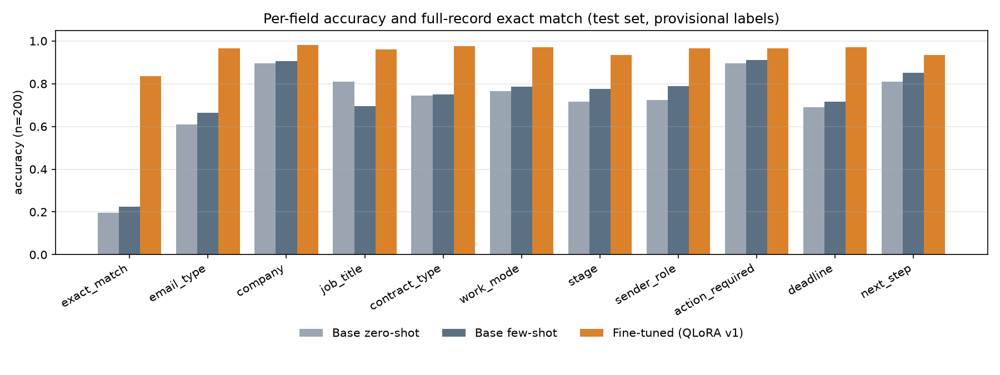
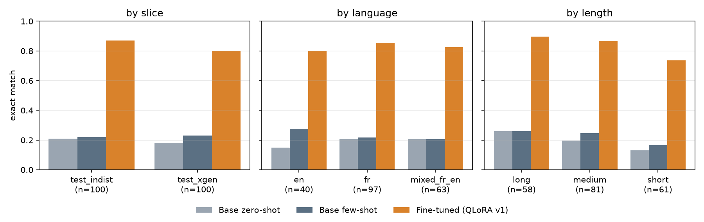
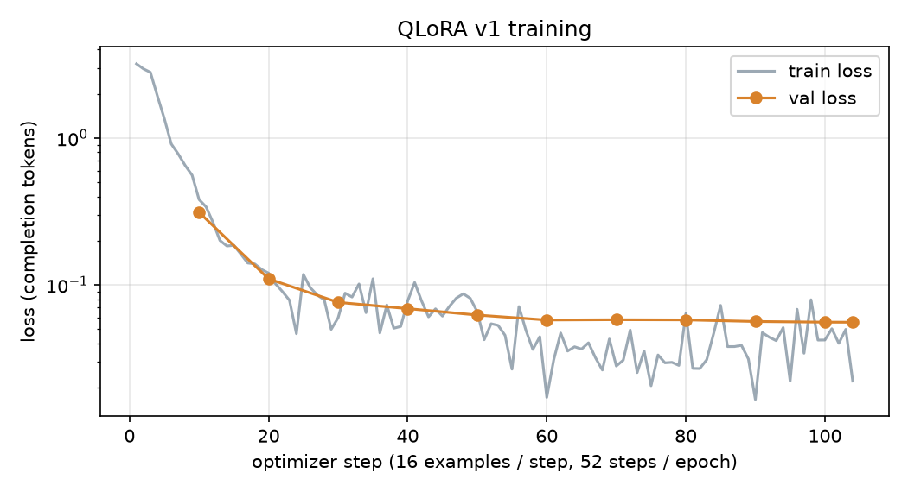

# email-extraction-qlora

Fine-tuning **Qwen3-4B-Instruct-2507** with QLoRA (free T4 GPU) to turn recruitment/HR emails
(French, English or mixed) into a schema-validated JSON record, and measuring it against the same
base model prompted zero-shot and few-shot.

**Model:** [huggingface.co/BenarbiaEmir/qwen3-4b-recruitment-email-json-qlora](https://huggingface.co/BenarbiaEmir/qwen3-4b-recruitment-email-json-qlora) (LoRA adapter, usage snippet in the model card).

```json
{"email_type": "assessment_request", "company": "Tesselmind", "job_title": "Software Engineer",
 "contract_type": "internship", "work_mode": "hybrid", "stage": "screening",
 "sender_role": "hiring_manager", "action_required": true, "deadline": "2026-10-22",
 "next_step": "Complete the technical test by 2026-10-22"}
```

> **Status.** Training data and test set are **synthetic**. The test labels are **provisional**:
> they passed automatic validation and a blind cross-model relabeling, but the hand review is not
> done yet. All numbers below may move once it is.

## Results

200 test emails, 4-bit base model in every row, greedy decoding.

| | Base zero-shot | Base few-shot | **Fine-tuned (QLoRA v1)** |
|---|---|---|---|
| Valid JSON | 100% | 100% | 100% |
| Schema-valid | 91.5% | 92.5% | **98.5%** |
| Rule-consistent (email_type × stage, ...) | 76.0% | 86.0% | **98.0%** |
| **Exact match** (9 fields) | 19.5% [14.0, 25.0] | 22.5% [17.0, 28.5] | **83.5% [78.0, 88.5]** |
| — in-distribution slice (generator A) | 21.0% | 22.0% | 87.0% |
| — cross-generator slice (generator B) | 18.0% | 23.0% | 80.0% |
| email_type | 61.0% | 66.5% | 96.5% |
| stage | 71.5% | 77.5% | 93.5% |
| sender_role | 72.5% | 79.0% | 96.5% |
| deadline | 69.0% | 71.5% | 97.0% |
| contract_type | 74.5% | 75.0% | 97.5% |
| Latency, mean (T4) | 8.4 s | 8.7 s | 13.4 s |

Brackets: bootstrap 95% CI. Paired difference fine-tuned − few-shot: +61.0 points [54.0, 68.0].
Validation set (105 emails, used only for checkpoint selection): 87.6% exact match.
Full tables: [`results/tables/`](results/tables), error lists: [`results/error_analysis/`](results/error_analysis).




**Reading the numbers.**
- The cross-generator slice (written by a different model than the training data) is the more
  honest headline: **80%**. Both slices are still synthetic.
- The fine-tuned model learned the labeling conventions from 824 examples; the base model only
  gets them as a ~520-token written summary. That gap is the point of fine-tuning, but it means
  the baseline numbers measure "following written rules", not general extraction ability.
- The blind relabeling (a second model labeling the test emails from text + rules) agreed with
  the gold on every field for 92–93% of emails. Part of the remaining 16.5% is label ambiguity,
  not model error (see below).

## What failed / surprised me

- **Base models invent labels outside the schema** (`sender_role: "tech_lead"`,
  `email_type: "final_interview"`, the string `"null"`): ~8% of baseline outputs fail the schema.
  The fine-tuned model still does it 3 times in 200 (`"peer"`, `"offer_ack"`).
- **Few-shot copies its examples.** Few-shot *lowers* job_title accuracy (81 → 69.5%): it invents a
  job title on 38 emails that name no role, mostly "Software Engineer", copied from one of its 3 examples. The
  examples were fixed before seeing test results and were not re-picked afterwards (that would be
  tuning the baseline on the test set).
- **Deadlines: I predicted failure and was wrong.** The base model resolves "avant lundi" from the
  Date header badly (32 of its 40 wrong dates are within a week of the gold). I expected weekday
  arithmetic to resist fine-tuning; it went 71.5 → 97%.
- **The fine-tuned model is ~60% slower**, despite a much shorter prompt and same-length outputs.
  Likely cause (not yet verified): the LoRA adapter runs unmerged on top of the 4-bit base,
  adding overhead on every generated token. Merging is planned for the demo.
- **Label ambiguity limits the score.** Remaining errors cluster on boundaries the rules leave
  open: `screening` vs `technical_interview` for a take-home test (6 cases), and `next_step` on
  application acknowledgements, which is null, "Wait for the company's answer" or something else
  across both train and test. These are open questions for the labeling rules (v1.5), not fixed yet.
- **Data generation took four rule revisions.** On the 100-email pilot, the generator and the
  blind relabeler agreed on every field for only 79% of emails. That led to labeling rules
  v1.1–v1.4 (company core brand, ATS relays, first call = screening, ...) and the pilot was
  discarded. Full-record agreement reached 92% on the final train set.
- **Training crashed on the first try** on current library versions: the LoRA weights were
  created in bf16, which the T4's fp16 gradient scaler cannot handle. Fixed by keeping the
  trainable weights in fp32 ([`src/train.py`](src/train.py)).

## How it was built

**Schema** ([`data/schema.json`](data/schema.json)): 10 flat fields, enums for type, contract,
work mode, stage and sender role; `deadline` must be null when no action is required. Labeling
rules with worked examples: [`data/labeling_rules.md`](data/labeling_rules.md).

**Synthetic data** ([`scripts/`](scripts)): Python samples a spec per email (type, language,
length, register, edge cases such as forwarded threads, relative deadlines, ATS templates,
timezones, typos) and a generator model writes the email and its label. Then:
- automatic checks: JSON Schema, cross-field rules, spec consistency, company canonicalization;
- **blind cross-model relabeling**: the other generator labels every email from the text and
  rules only; disagreements are flagged for review, never auto-dropped;
- **leakage check**: character 5-gram Jaccard between every train and test email (max 0.455,
  nothing dropped); test companies and people come from name pools disjoint from train.

Splits: 824 train, 105 val (whole generation batches), 200 test = 100 from the training generator
+ 100 from a different generator.

**Training** ([`src/train.py`](src/train.py), [`notebooks/02_train.ipynb`](notebooks/02_train.ipynb)):
4-bit nf4 base, LoRA r=16 / α=32 / dropout 0.05 on all linear layers, 2 epochs (104 steps,
batch 2 × grad accum 8), lr 2e-4 cosine, fp16, loss on the JSON completion only. Every example is
checked to fit in 1024 tokens before training starts, so no target is truncated. Best checkpoint by val loss.



**Prompts.** Baselines get a condensed version of the labeling rules (~520 tokens) as the system
prompt, plus 3 fixed train examples for few-shot. The fine-tuned model is trained and run with a
one-line instruction: with the full prompt, ~20% of training examples would exceed the 1024-token
budget. Each model is evaluated in its intended configuration.

**Model choice.** Qwen3-4B-Instruct-2507 (Apache 2.0, text-only, no thinking mode) over the
originally planned Qwen2.5-3B (older generation) and the newest Qwen3.5-4B / Gemma 4 E4B (hybrid
linear-attention or multimodal architectures with thinner tooling support on a free T4).

**Evaluation** ([`src/eval.py`](src/eval.py)): valid JSON, schema-valid, rule-consistent, per-field
accuracy and macro-F1, exact match over the 9 structured fields (`next_step` is free text and
scored separately), latency. Invalid outputs count as wrong on every field.

## Limitations

- **Synthetic only.** No real emails yet; real-world accuracy is unknown. A small anonymized real
  test split is the most important missing piece.
- **Provisional test labels** until the hand review (`scripts/review.py`) is done.
- Both generators are from the same model family; test company names are formulaic invented
  brands, and a few may collide with real companies by accident.
- Small subgroups: edge-case breakdowns in `results/tables/metrics_*.json` have n = 3–55.

## Reproduce

```bash
pip install -r requirements.txt matplotlib
python scripts/make_splits.py                 # splits + leakage check
# GPU (Colab T4): notebooks/01_baselines.ipynb, notebooks/02_train.ipynb
python src/eval.py --pred results/preds/ft_qlora_v1.jsonl --gold data/splits/test_provisional.jsonl --name ft_qlora_v1
python scripts/analyze.py                     # plots, CIs, error analysis
```

## Layout
- `data/` — schema, labeling rules, generation prompts, splits, review sheets
- `src/` — `train.py`, `infer.py`, `eval.py`, prompts, validation
- `scripts/` — data generation, relabeling, splits, review, analysis
- `notebooks/` — baselines, training + evaluation, demo (Colab)
- `app/` — Gradio demo (`python app/app.py --share`, GPU; loads the adapter from the Hub)
- `kaggle/` — alternative runner for Kaggle notebooks
- `results/` — predictions, tables, plots, error analysis
